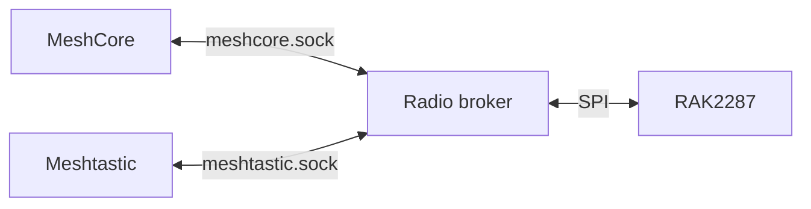

# RAK2287 Mesh Lab

Run MeshCore and Meshtastic as separate Linux programs on one RAK2287
EU868 concentrator. The lab lets you listen to both networks, exercise
shared transmission in simulation, and inspect the interfaces used by
both applications. It builds against a pinned
[rak2287-radio driver](https://github.com/guilhem/rak2287-radio).



## Run the simulation

Use Linux with Git, GNU Make 4.3 or later, a C11 compiler, a C++17 compiler,
`patch`, and Python 3. The test uses local Unix sockets and a fake radio.

```sh
git clone --recurse-submodules https://github.com/guilhem/rak2287-mesh-lab.git
cd rak2287-mesh-lab
make -j2 check
```

The app-level test checks that two clients receive on their own profiles
and take turns sending. The MeshCore test checks that an actual repeater
forwards through its broker socket.

## Listen on a Raspberry Pi

With a RAK2287 EU868 connected over SPI, `make -j2` builds the broker,
MeshCore observer, and MeshCore repeater. Follow the
[receive-only walkthrough](integration/shared-radio.md#listen-to-both-networks)
to start the broker and observe traffic.

| Radio | Receive profile |
| --- | --- |
| RF0 | Meshtastic Paris Medium Fast, 869.300 MHz, 250 kHz |
| RF1 | MeshCore EU Narrow, 869.618 MHz, 62.5 kHz |

In a four-minute black1 trial, the broker delivered 16 CRC-valid Meshtastic
frames and four CRC-valid MeshCore frames. [Hardware trial](integration/shared-radio.md#hardware-trial)

On black1, a transmit dry run at 869.300 MHz (250 kHz, SF9, CR 4/5)
loaded and read back a 23-byte Meshtastic frame in RF0's FIFO. The test
intercepted `SetTx` before it reached the radio. Both receive chains
resumed on their original profiles without a reset, 211 ms after the
driver began pausing them.

Transmission is off by default. The Paris channel overlaps French alarm
sub-bands. Shared transmission has been exercised with the native
applications and a simulated radio. RF transmission and decoding by a
second node remain unverified for this profile.
[Transmission limits](integration/shared-radio.md#simulate-shared-transmission)

## Integrate an application

- [Connect the mesh programs and read the socket contract](integration/shared-radio.md#connect-the-mesh-programs).
- [Build the Meshtastic Portduino adapter](integration/meshtastic/PORTDUINO.md).
- Override `DRIVER_ROOT` to test against a separate checkout of the driver.

The broker and Linux MeshCore glue use [BSD 3-Clause](LICENSE). The
Meshtastic adapter uses the firmware's GPL-3.0 license.
[Third-party notices](NOTICE.md)
